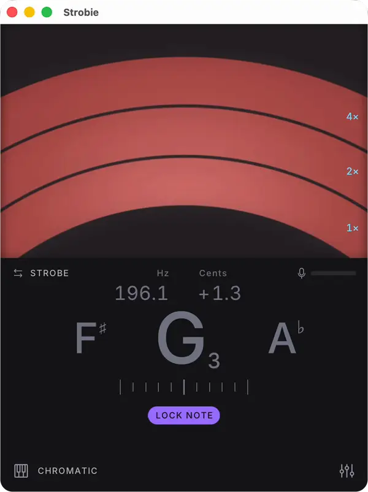
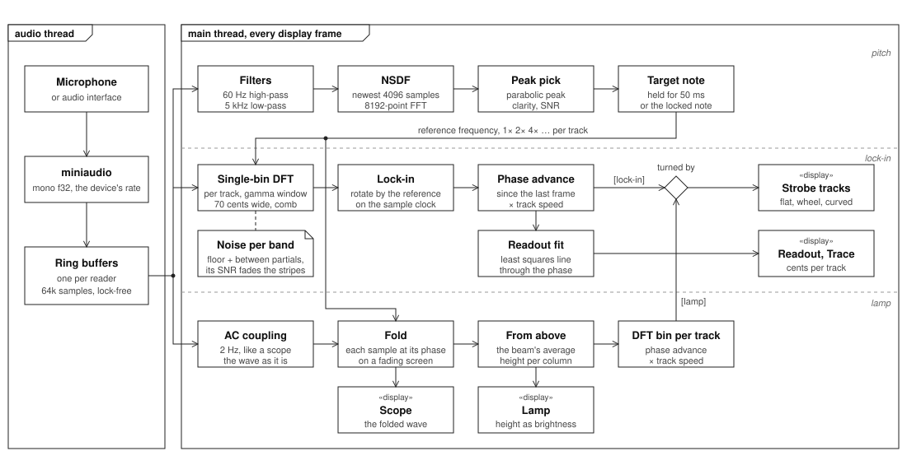
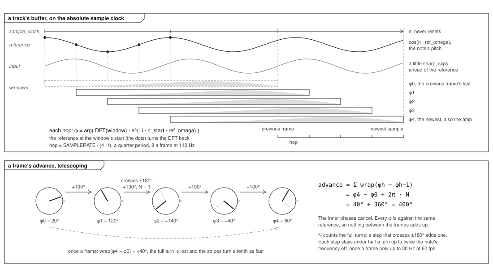

<div align="center">

# Strobie

A simple stroboscopic instrument tuner.



</div>


Strobie is coming to the App Store for Mac and iPhone. [Try it in your browser](https://strobie.app/try/), or read the source and build it yourself, see [Development](#development).

### Features

- Automatic pitch detection based on NSDF (McLeod Pitch Method).
- Smooth and responsive strobe display, the stripe sharpness adapts to the signal quality.
- Note lock: keeps the strobe on one note.
- Harmonic mode: shows the partials of the detected note on up to 5 strobe tracks.
- Track settings: tap a track to choose its partial (1× to 8×, or the fifth at 1½×), move its target by up to ±50 cents (e.g. for a stretched octave) and change its spin rate.
- Vernier mode: a geared mode that shows the same fundamental frequency in each band, but with increasing sensitivity.
- Spin rate: 200% spins the strobe twice as fast per cent, for the final adjustment.
- Readout speed: how long the cents average, 400 ms evens out a vibrato, 150 ms follows a turned peg sooner.
- In-tune tap on a phone: a haptic tap once the readout holds within a cent.
- Six displays, a menu under the strobe picks one, see [Displays](#displays):
  - Strobe: curved tracks, a wheel or flat tracks, turned by a lock-in on each partial or by the lamp.
  - Lamp: the mechanical strobe, stripes lit by the wave.
  - Scope: the waveform synced to the strobe's frequency, tap it for petals on a circle.
  - Trace: the cents over time.
  - Needle: the cents on a meter scale, a needle per partial.
  - Spectrum: the spectrum of what the pitch detection hears, the loudest peaks named.
- Note offsets: tune a note up to ±25 cents off pitch, the strobe stands still at the offset note.
- Transpose for B♭, E♭, F and other transposing instruments.
- Guitar, bass and ukulele tunings with an optional capo, the ruler shows only their strings.
- Concert A from 400 to 480 Hz.
- Hertz/Cents display.
- Four colorways (red, mint, amber, mono) and By note, a color per note. An optional retro glow.


### License

Copyright ©️ 2025–2026 Davorin Šego <br />
Licensed under the GPL v3  <br />
https://www.gnu.org/licenses/gpl-3.0.en.html


### Third-Party Resources


- [PortAudio](https://portaudio.com/) ring buffer, ported to Odin <br />
Portable Real-Time Audio Library <br />
Copyright (c) 1999-2011 Ross Bencina, Phil Burk <br />

- [The Inter typeface family](https://rsms.me/inter/) <br />
Copyright (c) 2016 The Inter Project Authors <br />
SIL Open Font License 1.1 <br />

- [Noto Sans](https://github.com/notofonts) <br />
Copyright 2022 The Noto Project Authors (https://github.com/notofonts/latin-greek-cyrillic) <br />
SIL Open Font License, Version 1.1 . <br />

- [SDL](https://libsdl.org/) <br />
Copyright (C) 1997-2025 Sam Lantinga <br />
Zlib license <br />

- [miniaudio](https://miniaud.io/) <br />
Copyright 2025 David Reid <br />
Public domain (Unlicense) or MIT No Attribution <br />

- [stb](https://github.com/nothings/stb) <br />
Copyright (c) 2017 Sean Barrett <br />
Public domain or MIT license <br />

- [Phosphor Icons](https://phosphoricons.com/) <br />
Copyright (c) 2023 Phosphor Icons <br />
MIT license <br />


### Development

You need [Odin](https://odin-lang.org/docs/install/), the [just](https://github.com/casey/just) command runner, git, clang (on macOS from the Xcode command line tools) and SDL3 (`brew install sdl3`). It draws with SDL3 GPU, Metal on macOS and iOS, Vulkan on Linux and Android.

```sh
git clone https://github.com/dsego/strobe-tuner
cd strobe-tuner
just dev
```

The first run clones and compiles the dependencies into `external/`, later runs skip that. The iOS, Mac app and Android builds link SDL in from `external/<platform>/sdl3`, built from source once with `just sdl macos`, `ios-device`, `ios-sim` or `android`, and again to update it.

| Command | What it does |
| --- | --- |
| `just dev` | Debug build, then runs it |
| `just dev stats` | Also shows the signal stats and NSDF plots |
| `just dev ios` | Builds for the iOS simulator and runs it there, needs Xcode |
| `just ipa` | Signed build for iPhone, see `platform/ios/build-device.sh`, needs Xcode and a provisioning profile |
| `just apk` | Debug signed build for Android, see [Android](#android) |
| `just build` | Optimized build for this machine |
| `just app` | The Mac app as `build/macos/Strobie.app`, signed ad hoc to run on this Mac, needs Xcode for the icon |
| `just pkg` | Signed build for the Mac App Store, see `platform/macos/build-pkg.sh`, links SDL in statically |
| `just test` | Unit tests of the pitch detection and strobe code |
| `just accuracy` | Generated tones with and without noise through the tuner, checks the note and the readout within 1¢, `just accuracy full` for every note and three concert pitches |
| `just recordings` | Your recordings in `sandbox/samples` (not in the repo), one note per file named like `strat_E2.wav`, shifted by known cents through the tuner, checks the readout follows the shift; `just recordings <folder> csv` for another folder as CSV |

Debug builds also have <kbd>Cmd</kbd><kbd>,</kbd> to open the config file and <kbd>Cmd</kbd><kbd>Shift</kbd><kbd>,</kbd> to reload it.

#### Linux

For development only, no release is planned, so there's no package and no icon. Not tried yet. It draws with Vulkan, `just dev` compiles the shaders with `glslc`, and needs SDL3 and a Vulkan driver. The audio libraries (PulseAudio, PipeWire through its PulseAudio server, or ALSA) are loaded at runtime. The first `just dev` also compiles Odin's vendored stb and miniaudio into the Odin folder, which has to be writable, the Linux install leaves them uncompiled.

```sh
sudo apt install clang git libsdl3-dev glslc  # Debian, Ubuntu
sudo dnf install clang git SDL3-devel glslc   # Fedora
just dev
```

The config is saved to `$XDG_CONFIG_HOME/Strobie/config.ini`, or `~/.config/Strobie/config.ini`.

#### Android

For development only, no release is planned, the launcher icon is the iOS one scaled down. `just apk` builds a debug signed `build/android/Strobie.apk`, see `platform/android/build.sh`. No Android Studio or Gradle, only the command line SDK, adb and a JDK for SDL's Java classes and the build tools. `just sdl android` compiles SDL into `external/android` first. The first build compiles stb into the Odin folder with the NDK, where Odin's bindings look for it.

```sh
brew install --cask android-platform-tools android-commandlinetools
brew install openjdk@17
```

Homebrew's JDK is keg-only, the system `java` doesn't find it and `sdkmanager` fails with "Unable to locate a Java Runtime". Point the shell at it in `~/.zshrc`:

```sh
export JAVA_HOME="$(brew --prefix openjdk@17)/libexec/openjdk.jdk/Contents/Home"
export PATH="$JAVA_HOME/bin:$PATH"
```

Then the SDK packages, `sdkmanager --list | grep ndk` shows the NDK versions:

```sh
sdkmanager "platform-tools" "platforms;android-35" "build-tools;35.0.0" "ndk;28.2.13676358"
```

To install on a phone, tap Build number in Settings → About phone 7 times, turn on USB debugging in Developer options, plug it in and accept the prompt from `adb devices`. `ANDROID_DEVICE=usb just apk` then installs and launches it. `adb logcat -s SDL` shows SDL's logs, `brew install scrcpy` mirrors the screen.


### How it works



#### Displays

The first five show how the note's phase slips against a reference at the target pitch, the sixth what the pitch detection hears:

- **Strobe**: the tracks of a strobe tuner, one per partial in harmonic mode, still when in tune, turning left when flat and right when sharp. Flat, a wheel or curved. They're turned by:
  - **Lock-in** (the default): each track measures its own partial with a single-bin DFT, see [Stroboscopic effect](#stroboscopic-effect).
  - **Lamp**: each track turns by its partial on the lamp's screen, a DFT bin of it, see [Folding](#ways-to-build-a-strobe). A pluck or a weak partial can make the stripes jump.
- **Lamp**: the disc of a mechanical strobe lit by a lamp that flashes with the wave. Every sample is folded onto two periods of the reference, the stripes as bright as the wave is high there. A detuned note drifts, and a fast drift smears to gray like on a real one. The height follows the crest height the note sustains over the last 18 periods, so the stripes stay lit until the note fades into the noise.
- **Scope**: the same folded screen drawn as a wave, an oscilloscope synced to the reference. Tapped, the sweep goes round a circle, two periods a turn, so a sine draws two lobes and the partials bump and dip them, spinning clockwise when sharp. A low-pass keeps the first few partials, delayed alike so the shape stays. The sweeps are averaged over the persistence with the reference as the trigger, so the noise cancels out and a detuned note smears like the stripes. The beam is a Solid line, or Phosphor, dim where it moves fast and bright where it lingers. The height is set like an oscilloscope's Autoset on every attack and every note lit from silence, following the average's peak for 18 periods and then held, so a decaying note shrinks into the noise instead of its tail being scaled up. With Gain on Uniform every sweep is divided by its RMS, so a tremolo or a decaying note stays the same size.
- **Trace**: the cents of the readout over the last few seconds, to see a vibrato or a drift.
- **Needle**: the readout's cents as a needle over a scale of cent marks, fine near in tune and coarser further out. Every partial has a needle of its own, a string's upper partials stand a few cents sharp of the fundamental; tapped, only the readout's stays. A needle fades with its stripes and stays dim at its last reading until the next pluck.
- **Spectrum**: the power spectrum of what the pitch detection hears, the loudest peaks named, a mark at each strobe track's partial. Not for tuning, its peaks are about 12 Hz wide: it shows what's there and how far over the noise, e.g. a fridge's hum louder than the string.

The cents readout comes from the lock-in in every display.

A tap on a view flips one of its options: the Scope's sweep, the Trace's range, the Needle's partials, the Lamp's rectifier and the Spectrum's scale. On the Strobe a tap on a track opens its settings.

#### Pitch detection

The pitch detection uses autocorrelation via FFT, the method of _"A Smarter Way to Find Pitch" (Philip McLeod, Geoff Wyvill)_, on the newest 4096 samples every frame. A 60 Hz high-pass takes out DC and rumble, which lift the NSDF between periods, and a 5 kHz low-pass the hiss above the highest note. Its clarity and the SNR tell a strong pitch from a weak one.

A new note has to hold for 50 ms before the strobe switches to it, so a single noisy detection of a decaying note doesn't reset the display.

#### Stroboscopic effect

The strobe is driven by a lock-in amplifier (heterodyne): a single-bin DFT tuned to the target note's reference frequency (e.g. 110 Hz) measures the signal's phase against a reference oscillator, and the stripes turn by it.

- Input: unfiltered. Each band's window and comb keep the note's other partials out, a track more than a semitone off fades and doesn't count for the readout.
- Frequency targeting: a windowed single-bin DFT at the reference frequency, over windows a hop apart through the frame's new samples, see below.
- Demodulation: the DFT result is rotated by the phase of a reference oscillator on an absolute sample clock. In tune this phase stands still, detuned it rotates at the frequency difference.
- Strobe motion: the stripes turn by the measured phase, times the track's speed.
- Readout: each track's cents are the slope of a least squares line through its phase, older measurements weighted down, restarted after each pluck.
- Stripe sharpness: the stripes are as sharp as the band's SNR allows and fade out into the noise, see [Noise floor](#noise-floor). They fade by the track's envelope, so a weak partial's swinging level doesn't flicker them, and also by how far the track drifts off the note.

Every track's window is sized for a band 70 cents wide around the fundamental, about 0.22 s at 110 Hz, gamma shaped and weighted toward the newest samples like an analog lock-in's low-pass, so the phase is as of about 60 ms ago instead of half the window. It's also smoothed with a box one period of the note long (two for a fifth), a comb whose nulls fall on the other partials.

Measured once a frame, a track more than half the frame rate off would alias, 30 Hz at 60 fps. So the phase is measured every quarter period of the note through the frame's new samples, and the frame's advance is the sum of the steps between them, each the shortest way. Every hop is against the same reference on the sample clock, so the steps telescope and nothing adds up from frame to frame.



The phase is rescaled so every note spins at the same rate per cent, and being a measured phase it can be multiplied by any factor: the track speed, the spin rate and the vernier mode are built on that.

#### Readout

The cents readout follows the fundamental's track. A string's partials are stretched, a few cents sharp of whole multiples on a wound guitar string, so every track reads its own cents. The fundamental reads out whenever its stripes fully show, however weak it is; otherwise the loudest fully lit octave track takes over. Once a track has read for 50 ms after a pluck, the readout stays on it until the next pluck or until its stripes fade, e.g. a low string's fundamental dying first.

Other ways to make one number of a note:
- A pitch detector's cents: the period of the whole wave, pulled sharp by the stretched partials. Here the pitch detector only picks the note.
- A blend of the partials' cents, close to the pitch the ear hears. It reads sharp of the fundamental on a stretched string and moves as the upper partials die away.
- A partial the player picks, e.g. the 2× to tune octaves. Not built.


#### Ways to build a strobe

The ways to turn the samples into a strobe display, what goes wrong with each, and which ones are in the app.

1. **Cutting frames** (tried and dropped): each frame takes the newest samples and lines one reference period up with the pattern. No smear, a fast drift jumps from frame to frame instead of washing out to gray; a high note's few samples per period make the pattern move in blocks or jitter; and each band needs an IIR bandpass, whose phase shift differs from band to band.
2. **Folding** (the Lamp and the Scope): every sample is placed on the screen at its phase of the reference and the screen fades like phosphor. Nothing is rounded or resampled, and the smear comes by itself: a slow drift stays sharp, a fast one washes out. A DFT bin of the screen per partial gives its phase as a number, that's how the lamp turns the strobe tracks, though a pluck or a weak partial on the screen can make the stripes jump.
   - Through a square-wave slot: [strobeTuner](https://sourceforge.net/projects/strobetuner/) (Scott Duplichan, GPLv3) multiplies the last 6 periods by a ±1 square wave at the band's pitch for each column, the same fold through a slot half a period wide, like a real disc's half black, half clear stripes.
   - Through a flash lamp: [Stroboscopic Tuner](https://github.com/AdamFoster/StrobeTuner) (Adam Foster, GPL-3.0) fires the lamp only on samples above 70% of the frame's peak, like a neon lamp, with rings at ¼× to 8× the note. Nothing persists between frames, so a fast drift flickers instead of smearing.
3. **Phase lock** (the default): the lock-in measures each partial's phase against the reference on the samples themselves, see [Stroboscopic effect](#stroboscopic-effect). The phase is continuous and shifts alike in every band, so the stripes move smoothly at any pitch.
4. **Flashed once a period** (tried as a measurement and dropped): a pattern shows only at one point of each period of the note, its upward zero crossing or its peak, like a lamp flashing on a disc. It needs each partial band-passed out first and reads one instant a period where the lock-in uses every sample: on a weak partial it jittered about twice as much, and a low string's weak fundamental was lost under its 2nd partial.
5. **Simulated from a pitch detector**: a pitch detector like NSDF or YIN gives the period but not where the wave is. Stripes turned by the detected cents drift with its noise while the note holds, a jump in phase doesn't show, and harmonic tracks can only be multiples of one f0. Here the pitch detector only picks the note.


#### Noise floor

Each strobe band keeps an estimate of the background noise at its frequency, which gives the SNR for the stripes and the readout; the pitch detector keeps one for the whole signal. It follows the level while nothing louder plays and only creeps up slowly to catch a noisier room. It never goes up on a pitch, so a held note doesn't become the background, and it's relearned when the input changes or reopens.

An instrument also brings noise of its own, an acoustic guitar's body and the room ringing with the attack, rising with the pluck and fading with the note. So each band also measures the noise between the note's partials, the median of an FFT's bins in the gaps over the last half second. The two noises add as powers.
