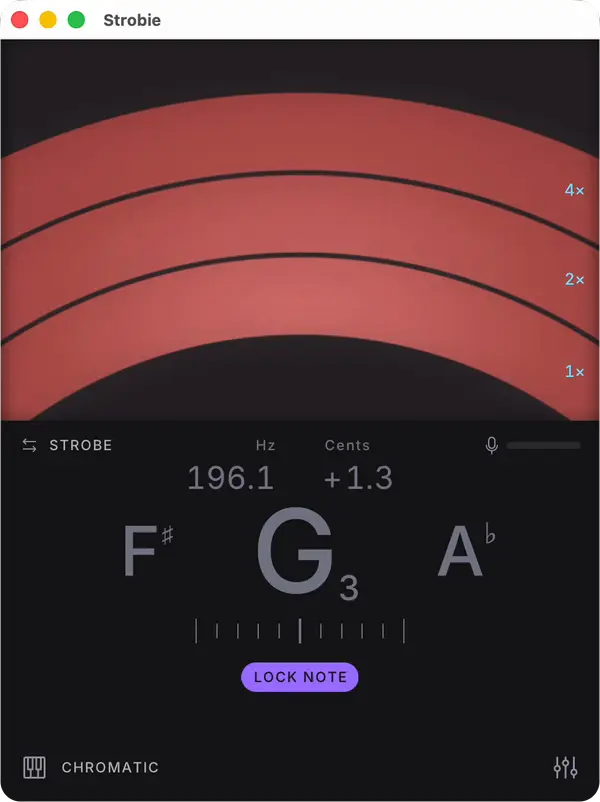
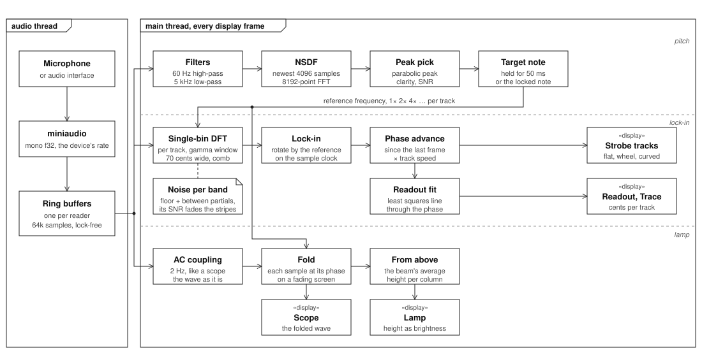
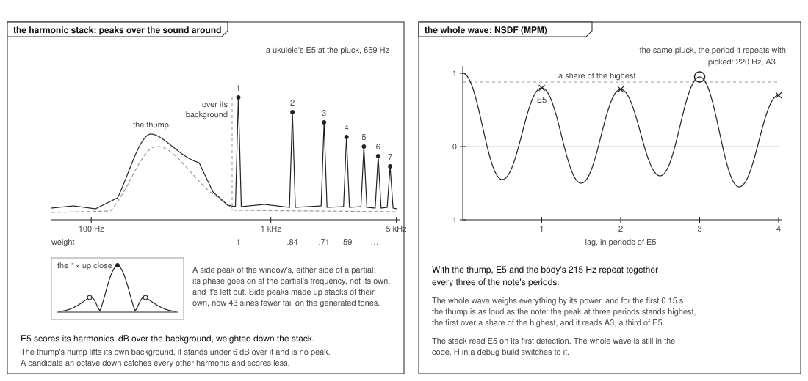
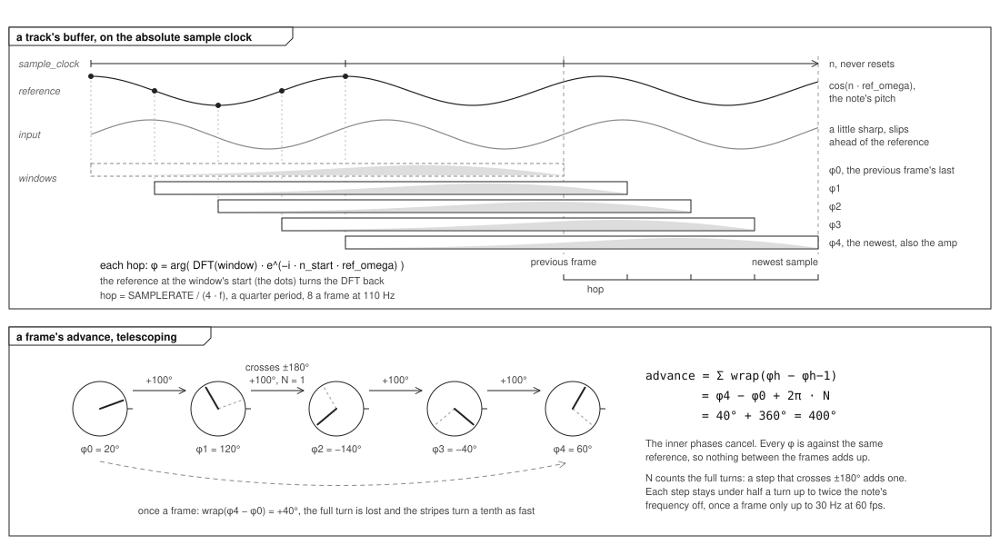
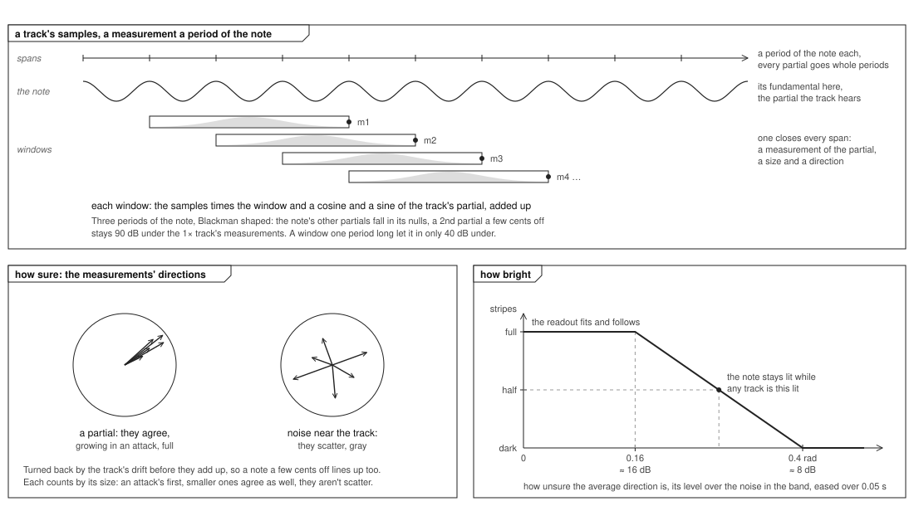

<div align="center">

# Strobie

A simple stroboscopic instrument tuner.



</div>


Strobie is coming to the App Store for Mac and iPhone. You can [try it in your browser](https://strobie.app/try/) now, or build it from source as described in [Development](#development).

### Features

- Multi-harmonic pitch detection: the note is found from all of its harmonics by subharmonic summation, and a string's slightly stretched partials still count.
- Smooth, responsive strobe display. The stripes fade to gray when noise makes a partial's phase uncertain.
- Note lock: keeps the strobe on one note.
- Harmonic mode: shows the partials of the detected note on up to 5 strobe tracks.
- Track settings: tap a track to choose its partial (1× to 8×, or the fifth at 1½×), to move its target by up to ±50 cents (for example for a stretched octave), or to change its spin rate.
- Vernier mode: every track shows the fundamental, and each track turns twice as fast as the one before it, so the slow tracks show large errors and the fast tracks show small ones.
- Spin rate: at 200% and 400% the strobe turns two and four times as fast for the same error, which helps with the final adjustment. At 400% the readout and the track cents show hundredths of a cent below 10 cents.
- Readout: hertz and cents to a tenth. It reads the fundamental's track, the 2× track, or a blend of the whole sound like most tuners. A guitar or piano string is stiff, so its partials run a little sharp and these three read a few cents apart; see [Readout](#readout).
- Readout speed: how long the cents are averaged. 400 ms evens out a vibrato, and 150 ms follows a string being tuned with less delay.
- Five displays, chosen from a menu under the strobe (see [Displays](#displays)):
  - Strobe: curved tracks, a wheel, or flat tracks, each turned by a lock-in on its partial.
  - Lamp: a mechanical strobe disc whose stripes are lit by the wave itself.
  - Scope: the waveform, synced to the strobe's frequency. A tap wraps it around a circle.
  - Trace: the cents over time.
  - Spectrum: the spectrum the pitch detection works on, with the loudest peaks named.
- Note offsets: tune any note up to ±25 cents away from equal temperament. The strobe stands still at the offset pitch.
- Transpose for B♭, E♭, F and other transposing instruments.
- Guitar, bass and ukulele tunings, with an optional capo. The ruler then shows only the instrument's strings.
- Custom instrument: a preset of up to 10 notes of your own, such as a handpan's scale or a tuning that isn't built in. The ruler then shows only those notes.
- Concert A from 390 to 480 Hz, with 440, 442 and 432 in a menu.
- Hertz and cents display.
- Four colorways (red, mint, amber and mono), plus By note, which gives each note its own color. There is also an optional retro glow.


### License

Copyright ©️ 2025–2026 Davorin Šego <br />
Licensed under the GPL v3  <br />
https://www.gnu.org/licenses/gpl-3.0.en.html


### Third-Party Resources


- [PortAudio](https://portaudio.com/) ring buffer, ported to Odin <br />
Portable Real-Time Audio Library <br />
Copyright (c) 1999-2011 Ross Bencina, Phil Burk <br />

- [The Inter typeface family](https://rsms.me/inter/) <br />
Copyright (c) 2016 The Inter Project Authors <br />
SIL Open Font License 1.1 <br />

- [Noto Sans](https://github.com/notofonts) <br />
Copyright 2022 The Noto Project Authors (https://github.com/notofonts/latin-greek-cyrillic) <br />
SIL Open Font License, Version 1.1 . <br />

- [SDL](https://libsdl.org/) <br />
Copyright (C) 1997-2025 Sam Lantinga <br />
Zlib license <br />

- [miniaudio](https://miniaud.io/) <br />
Copyright 2025 David Reid <br />
Public domain (Unlicense) or MIT No Attribution <br />

- [stb](https://github.com/nothings/stb) <br />
Copyright (c) 2017 Sean Barrett <br />
Public domain or MIT license <br />

- [Phosphor Icons](https://phosphoricons.com/) <br />
Copyright (c) 2023 Phosphor Icons <br />
MIT license <br />


### Development

You need [Odin](https://odin-lang.org/docs/install/) dev-2026-11 or later, the [just](https://github.com/casey/just) command runner, git, clang (on macOS it comes with the Xcode command line tools) and SDL3 (`brew install sdl3`). Strobie draws with SDL3's GPU API, which uses Metal on macOS and iOS and Vulkan on Linux and Android.

```sh
git clone https://github.com/dsego/strobe-tuner
cd strobe-tuner
just dev
```

The first run clones the dependencies into `external/` and compiles them; later runs skip this step. The iOS, Mac app and Android builds link SDL from `external/<platform>/sdl3`. Build it from source once with `just sdl macos`, `just sdl ios-device`, `just sdl ios-sim` or `just sdl android`, and run the same command again to update it.

| Command | What it does |
| --- | --- |
| `just dev` | Makes a debug build and runs it. |
| `just dev stats` | Like `just dev`, and also shows the signal statistics and a plot of the pitch detection (the harmonic stack, or the NSDF (MPM)). |
| `just dev unlock` | Runs with the one-time unlock and a pretend store: 10 s free, then a reminder every 15 s. `UNLOCK=storekit just ipa` or `UNLOCK=storekit just pkg` sells the unlock through the App Store. Without `UNLOCK`, the whole app is free. |
| `just dev ios` | Builds for the iOS simulator and runs it there. Needs Xcode. |
| `just ipa` | Signed build for iPhone, see `platform/ios/build-device.sh`. Needs Xcode and a provisioning profile. |
| `just apk` | Debug-signed build for Android, see [Android](#android). |
| `just build` | Optimized build for this machine, written to `build/strobie`. |
| `just app` | The Mac app as `build/macos/Strobie.app`, signed ad hoc to run on this Mac. Needs Xcode for the icon. |
| `just pkg` | Signed build for the Mac App Store, see `platform/macos/build-pkg.sh`. SDL is linked statically. |
| `just test` | Unit tests of the pitch detection and strobe code. |
| `just accuracy` | Plays generated tones, with and without noise, through the tuner and checks the note and that the readout is within 1¢. `just accuracy full` covers every note at three concert pitches. |
| `just recordings` | Shifts your recordings in `sandbox/samples` (not in the repo) by known amounts of cents, plays them through the tuner, and checks that the readout follows the shift. Each file holds one note and is named like `strat_E2.wav`. `just recordings <folder> csv` reads another folder and writes CSV. |

In debug builds, <kbd>Cmd</kbd><kbd>,</kbd> opens the config file and <kbd>Cmd</kbd><kbd>Shift</kbd><kbd>,</kbd> reloads it.

#### Linux

The Linux build is for development only. No release is planned, so there is no package and no icon, and the build has not been tried yet. It draws with Vulkan and needs SDL3 and a Vulkan driver; `just dev` compiles the shaders with `glslc`. The audio libraries (PulseAudio, PipeWire through its PulseAudio server, or ALSA) are loaded at runtime. Odin's Linux install leaves its vendored stb and miniaudio uncompiled, so the first `just dev` compiles them into the Odin folder, which has to be writable.

```sh
sudo apt install clang git libsdl3-dev glslc  # Debian, Ubuntu
sudo dnf install clang git SDL3-devel glslc   # Fedora
just dev
```

The config is saved to `$XDG_CONFIG_HOME/Strobie/config.ini`, or `~/.config/Strobie/config.ini`.

#### Android

The Android build is for development only, and no release is planned. The launcher icon is the iOS icon scaled down. `just apk` builds a debug-signed `build/android/Strobie.apk` (see `platform/android/build.sh`). It doesn't use Android Studio or Gradle, only the command-line SDK, adb, and a JDK for SDL's Java classes and the build tools. Run `just sdl android` first to compile SDL into `external/android`. The first build compiles stb into the Odin folder with the NDK, because that is where Odin's bindings look for it.

```sh
brew install --cask android-platform-tools android-commandlinetools
brew install openjdk@17
```

Homebrew's JDK is keg-only, so the system `java` doesn't find it and `sdkmanager` fails with "Unable to locate a Java Runtime". Point the shell at it in `~/.zshrc`:

```sh
export JAVA_HOME="$(brew --prefix openjdk@17)/libexec/openjdk.jdk/Contents/Home"
export PATH="$JAVA_HOME/bin:$PATH"
```

Then install the SDK packages. `sdkmanager --list | grep ndk` lists the available NDK versions:

```sh
sdkmanager "platform-tools" "platforms;android-35" "build-tools;35.0.0" "ndk;28.2.13676358"
```

To install on a phone, tap Build number in Settings → About phone 7 times, turn on USB debugging in Developer options, plug the phone in, and accept the prompt that appears when you run `adb devices`. `ANDROID_DEVICE=usb just apk` then installs and launches the app. `adb logcat -s SDL` shows SDL's logs, and `scrcpy` (`brew install scrcpy`) mirrors the phone's screen.


### How it works



#### Displays

The first four displays show how the note's phase slips against a reference at the target pitch. The fifth shows what the pitch detection hears.

- **Strobe**: the tracks of a strobe tuner, one per partial in harmonic mode. A track stands still when its partial is in tune, and it turns left when flat and right when sharp. The tracks can be flat, curved, or a wheel. Each track measures its own partial with a single-bin DFT (a lock-in); see [Stroboscopic effect](#stroboscopic-effect).
- **Lamp**: the disc of a mechanical strobe, lit by a lamp that flashes with the wave. Every sample is folded onto two periods of the reference, and the stripes are as bright as the wave is high at that point. A detuned note drifts, and a fast drift smears to gray as it does on a real disc. The wave's height follows how loud the note is on a dB scale, measured as the note's peak over the Persistence span or over at least the last 18 periods. A peak of −6 dBFS fills the screen, and each dB quieter is one step lower, so a hum is about half as bright as a note sung out, and a fading note dims as it fades. The Lamp's own Gain, up to 400%, makes a quiet note brighter and widens a loud note's crests. Its Low-pass, the same filter as the Scope's, takes the room's hiss out of the stripes.
- **Scope**: the same folded screen drawn as a wave, like an oscilloscope synced to the reference. A tap wraps the sweep around a circle, two periods per turn by default. A sine then draws two lobes, the partials add bumps and dips to them, and the shape spins clockwise when the note is sharp. Periods sets how many periods (1 to 4) are drawn across the screen or around the circle. Gain draws the wave up to 400% as high as its loudness alone would, so a louder note can run off the screen. A low-pass filter keeps the first few partials and delays them all equally, so the wave keeps its shape. The sweeps are averaged over the Averaging span, triggered by the reference, so noise cancels out and a detuned note smears like the stripes. The beam is either a Solid line or Phosphor, which is dim where the beam moves fast and bright where it lingers. As on the Lamp, the wave's height follows how loud the note is, with or without averaging.
- **Trace**: the readout's cents over the last few seconds, which shows a vibrato or a drift. A dot a little way in from the right edge marks the current reading and draws the line.
- **Spectrum**: the power spectrum the pitch detection works on, with the loudest peaks named and a mark at each strobe track's partial. It isn't meant for tuning, because its peaks are about 12 Hz wide. It shows what is in the sound and how far above the noise it stands, for example a fridge's hum that is louder than the string.

In every display, the cents readout comes from the lock-in, or from the pitch detection when Readout is set to Blend; see [Readout](#readout).

Tapping a display switches one of its options: the Scope's sweep, the Trace's range, the Lamp's rectifier, or the Spectrum's scale. On the Strobe, tapping a track opens that track's settings.

#### Pitch detection

Every frame, the pitch detection looks for the best stack of harmonics in the spectrum of the newest 4096 samples, following Hermes' subharmonic summation. Each peak counts by how far it stands above the sound around it, not by its level, and only peaks where a candidate's first ten harmonics fall count at all. So a pluck's body thump, a song's bass and drums, or a fridge's hum don't add to a note's stack. Each peak's weight is also scaled by how well its phase continued from the previous frame at the peak's own frequency, which is how MP3's psychoacoustic model tells a tone from noise. A window's side peaks around a partial move at the partial's frequency rather than their own, so they no longer form stacks of their own. The fundamental's frequency weighs each harmonic the way the period of the whole wave would, so the Blend readout reads the same mix of partials. A 20 Hz high-pass filter removes DC and the rumble below the lowest note, and a 5 kHz low-pass filter removes the hiss above the highest note. How far the stack stands out separates a clear tone from a weak pitch. The detection keeps the octave of the note it is following, because a steady octave is better than one that flips.

The pitch detection keeps its own noise floor for the whole signal, and the input settings show the floor and the level above it. The floor follows the level while nothing louder is playing. It rises only slowly, to adapt to a noisier room, and never while a pitch is detected. It is relearned when the input changes or reopens.

The code also contains a second method, the period of the whole wave by McLeod's NSDF (MPM). It uses autocorrelation via FFT, after _"A Smarter Way to Find Pitch" (Philip McLeod, Geoff Wyvill)_, and the H key switches to it in a debug build. This method weighs everything by its power. A ukulele's pluck thumps its body near 215 Hz as loudly as the note, the two together repeat every three of the note's periods, and so it read E5 as A3 for 0.15 s. The harmonic stack misses a low note with a weak fundamental when the note steps by exactly half a semitone; see [KNOWN_ISSUES.md](KNOWN_ISSUES.md).



A new note has to hold for 50 ms before the strobe switches to it, so that a single noisy detection of a decaying note doesn't reset the display. Its last two detections also have to agree within 5 cents. This is because a window that spans a jump in the wave's phase, such as a tone generator starting a new note from zero, reads past the new pitch for as long as the window lasts. Without the 5-cent rule, that overshoot carried a note held 55 cents sharp over to the next note. An octave or another harmonic of the lit note has to hold for 100 ms.

#### Stroboscopic effect

The strobe is driven by a lock-in amplifier (a heterodyne). A single-bin DFT tuned to the target note's reference frequency (for example 110 Hz) measures the signal's phase against a reference oscillator, and the stripes turn by that phase.

- Input: unfiltered. Each track's window and comb keep the note's other partials out. A partial further off than the track's 70-cent band fades out and doesn't count for the readout.
- Frequency targeting: a windowed single-bin DFT at the reference frequency, computed over windows a hop apart through the frame's new samples (see below).
- Demodulation: the DFT result is rotated by the phase of a reference oscillator on an absolute sample clock. When the partial is in tune, this phase stands still; when it is detuned, the phase rotates at the frequency difference.
- Strobe motion: the stripes turn by the measured phase multiplied by the track's speed.
- Readout: each track's cents are the slope of a least-squares line through its phase, with older measurements weighted less. The fit restarts after each pluck.
- Stripe brightness: the stripes are as bright as the track is sure of its partial, and they fade as noise makes it unsure (see [Stripe fade](#stripe-fade)). Far off the note their edges also soften, starting at about 35 cents, and at 75 cents the stripes are gone.

Every track's window is sized for a band 70 cents wide around the fundamental, which is about 0.22 s at 110 Hz. The window is gamma shaped and weighted toward the newest samples, like an analog lock-in's low-pass filter, so the measured phase is about 60 ms old instead of half the window's length. The window is also smoothed with a box one period of the note long (two periods for a fifth). The box acts as a comb filter whose nulls fall on the note's other partials.

If the phase were measured once per frame, a partial more than half the frame rate off the track would alias (30 Hz at 60 fps). So the phase is measured every quarter period of the note through the frame's new samples, and the frame's advance is the sum of the steps between these measurements, each step taken the shortest way round. Every measurement is against the same reference on the sample clock, so the steps telescope and no error builds up from frame to frame.



The phase is rescaled so that every note spins at the same rate per cent of detuning. Because it is a measured phase, it can be multiplied by any factor, and the track speed, the spin rate and the vernier mode are all built on that.

#### Readout

The cents readout follows one strobe track, the fundamental's by default. A string is stiff, so its partials run sharp of whole multiples (by a few cents on a wound guitar string), and every track reads its own cents. The chosen track is read whenever its stripes are fully lit, however weak the partial is; otherwise the loudest fully lit octave track takes over. Once a track has been read for 50 ms after a pluck, the readout stays on it until the next pluck or until its stripes fade, for example when a low string's fundamental dies away first.

The Readout setting chooses what the readout, the gauge and the trace show:
- 1×: the fundamental's track.
- 2×: the 2nd partial's track, for example to tune octaves.
- Blend: the pitch detector's cents, with the partials weighted the way the period of the whole wave weights them, which is how most tuners measure. The result lands among the partials, and the louder ones count more. A stiff string's sharp partials put it a few cents above the fundamental's track, and it drifts as they die away. On a Strat's low E it went from +7¢ to −1¢ over 9 s, while the 1× track read −6¢ to −8¢. On a wind instrument or a voice it reads the same as 1×.

Not built: averaging the tracks' own cents by their level, which would be a blend with the strobe's precision. On a stretched string it would read sharp of the fundamental and move as the upper partials die away, as the pitch detector's blend does.


#### Ways to build a strobe

There are several ways to turn the samples into a strobe display. This section lists them, what goes wrong with each, and which ones the app uses.

1. **Cutting frames** (tried and dropped): each frame takes the newest samples and lines one reference period up with the pattern. Nothing smears, so a fast drift jumps from frame to frame instead of washing out to gray. A high note has few samples per period, so the pattern moves in blocks or jitters. Each band also needs an IIR bandpass filter, and its phase shift differs from band to band.
2. **Folding** (the Lamp and the Scope): every sample is placed on the screen at its phase of the reference, and the screen fades like phosphor. Nothing is rounded or resampled, and the smear comes naturally: a slow drift stays sharp and a fast one washes out. One DFT bin of the screen per partial gives that partial's phase as a number. Folding turned the strobe tracks for a while, but a pluck or a weak partial on the screen made the stripes jump.
   - Through a square-wave slot: [strobeTuner](https://sourceforge.net/projects/strobetuner/) (Scott Duplichan, GPLv3) multiplies the last 6 periods by a ±1 square wave at the band's pitch for each column. This is the same fold seen through a slot half a period wide, like a real disc's half-black, half-clear stripes.
   - Through a flash lamp: [Stroboscopic Tuner](https://github.com/AdamFoster/StrobeTuner) (Adam Foster, GPL-3.0) fires the lamp only on samples above 70% of the frame's peak, like a neon lamp, and shows rings at ¼× to 8× the note. Nothing persists between frames, so a fast drift flickers instead of smearing.
3. **Phase lock** (the default): the lock-in measures each partial's phase against the reference, directly on the samples (see [Stroboscopic effect](#stroboscopic-effect)). The phase is continuous and shifts the same way in every band, so the stripes move smoothly at any pitch.
   - By its speed (tried and dropped): two windows a short hop apart give how fast the phase turns, and every frame the stripes turn at that speed. Each frame stands alone, so this is cheap and smooth at any frame rate. But the stripes then show the speed added up, not the phase: a jump in phase doesn't show, the stripes drift with the speed's noise, and a shorter hop reaches further off the note but is noisier. The lock-in keeps the phase from frame to frame instead, so the stripes show where the wave is.
4. **Flashed once a period** (tried as a measurement and dropped): the pattern is shown only at one point in each period of the note, its upward zero crossing or its peak, like a lamp flashing on a disc. Each partial has to be band-passed out first, and the method reads one instant per period where the lock-in uses every sample. On a weak partial it jittered about twice as much, and a low string's weak fundamental was lost under its 2nd partial.
5. **Simulated from a pitch detector**: a pitch detector such as NSDF (MPM) or YIN gives the period, but not where the wave is. Stripes turned by the detected cents drift with the detector's noise while the note holds, a jump in phase doesn't show, and harmonic tracks can only be multiples of one f0. In Strobie the pitch detector only picks the note.


#### Stripe fade

Each track also measures its partial over short windows. The windows are Blackman shaped and three periods of the note long, and one window closes every period. Over whole periods of the note, the note's other partials cancel, and the smooth window keeps them out even when the note is a little off. Each measurement gives the partial's size and direction. Older measurements are turned back by the phase advance the lock-in measured over the same time, so while the partial is present the measurements point the same way. An attack's first measurements only grow in size. Noise scatters their directions. The stripes fade by how uncertain this makes the direction of their average: they are fully lit while it is within about 0.16 radians, and they are dark from 0.4 radians. A partial that shimmers goes dark at once, and a steady one stays lit to the end of its decay, however quiet it gets. The readout fits and follows only fully lit tracks, and the note stays lit while any track's stripes are at least half lit.

The fade does not use the lock-in's phases. The lock-in measures over long windows, about 24 periods of the note at 110 Hz, and starts a new window every quarter period. Neighbouring lock-in windows share almost all of their samples, so their phases agree even when the signal is only noise. The fade therefore takes its own measurements over the short windows described above. Neighbouring short windows share about a third of their noise, and windows two apart share about 1%, so the fade counts every 1.7 measurements as one independent measurement. Each of these measurements is a single-bin DFT like the lock-in's, summed while the samples arrive: every sample is added once to each of the three open windows, so the fade costs much less than the lock-in.


